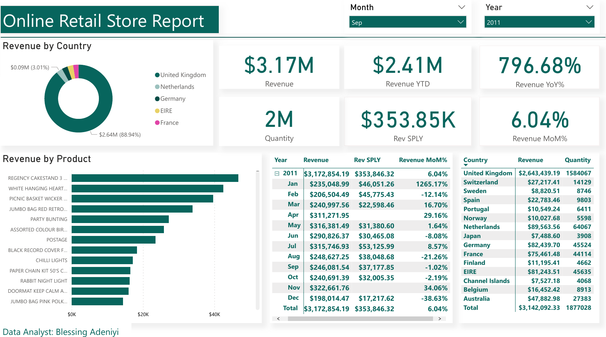

# Online Retail Sales Dashboard

**Tools:** Power BI, Power Query, DAX · **Data:** transactions from a UK based online gift retailer, December 2010 to December 2011 (the widely used "Online Retail" public dataset)

## Business question

Management wanted one view of **how revenue was trending month by month, which countries and products drove it, and how this year compared with last**.

## What I did

* Cleaned and transformed the transaction data in Power Query
* Built a date table and DAX measures for revenue, year to date, same period last year, and month over month change
* Designed a dashboard with month and year filters, a monthly revenue table, revenue by country and top products

## Key findings

| Measure | Result |
|---|---|
| Revenue, 2011 | **$3.17M** |
| Quantity sold | **about 2M units** |
| Biggest market | **United Kingdom: $2.64M, about 89% of revenue** |
| Next markets | Netherlands ($90K), Germany ($82K), EIRE ($81K), France ($75K) |
| Peak month | **November 2011: $323K**, up 34% on October, ahead of the holiday season |

## A caveat I'd flag today

The dashboard shows revenue **up 797% year over year**. That figure is misleading: the dataset only starts in **December 2010**, so 2011 is being compared with a single month. Today I would show year over year only for months with data in both years, or compare December with December.

## Recommendations

* Reduce dependence on the UK by growing the **Netherlands, Germany, EIRE and France**, which already buy in volume.
* Plan stock and marketing for the **September to November** build up to the holidays.

## Files

| File | Contents |
|---|---|
| `Online Retail Store Report 1.pdf` | Dashboard |
| `images/` | Dashboard image |
